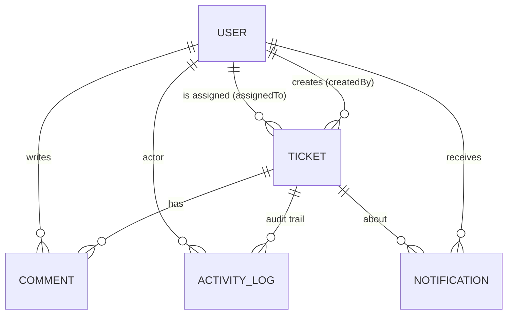

# Database design (MongoDB + Mongoose)

MongoDB fits this domain well: tickets are read as whole documents, comments/logs are append-heavy, and
the schema is small and stable. Relationships are modelled with **references** (ObjectId) rather than
embedding, because comments and logs grow without bound and are queried independently.

## Collections

### users
| Field | Type | Notes |
|---|---|---|
| name | String 2–50 | |
| email | String | unique index, lower-cased |
| password | String | bcrypt hash (cost 12), `select: false`, never serialised |
| role | `user` \| `admin` | default `user`; admins are only created by script |
| isActive | Boolean | admins can deactivate; checked on **every** request |

### tickets
| Field | Type | Notes |
|---|---|---|
| title / description / category | String | length-validated |
| priority | `low` `medium` `high` `urgent` | default `medium` |
| status | `open` `in_progress` `resolved` `closed` | transitions enforced in `STATUS_TRANSITIONS` |
| createdBy | ref User | owner |
| assignedTo | ref User \| null | admin handling the ticket |
| commentCount | Number | denormalised counter ($inc) so lists need no join |
| firstResponseAt | Date \| null | set once, on first admin comment (response-time metric) |
| resolvedAt / closedAt | Date \| null | for resolution-time metric; cleared on reopen |
| lastActivityAt | Date | bumped on edit / status / comment |
| deletedAt | Date \| null | **soft delete** – history and audit log are preserved |

Indexes: `{createdBy, deletedAt, createdAt:-1}` (my tickets), `{deletedAt, status, priority, createdAt:-1}`
(admin filters), `{assignedTo, status}`.

### comments
`ticketId`, `userId`, `message` (≤2000), `isAdminResponse` (role snapshot at write time). Index `{ticketId, createdAt}`.

### activitylogs (append-only audit trail)
`ticketId`, `actorId`, `event`, `details`, `metadata` (free-form: previous/new values, changed fields…), `createdAt`.
Index `{ticketId, createdAt:-1}`.

### notifications
`userId` (recipient), `ticketId`, `event`, `message`, `readAt`. Index `{userId, readAt, createdAt:-1}` plus a
**TTL index** that deletes notifications after 90 days.

## Design decisions
* **Soft delete** for tickets – deleting is a requester action, but support history must stay auditable.
* **Denormalised counters/timestamps** (`commentCount`, `firstResponseAt`, `resolvedAt`) turn dashboard
  metrics into cheap aggregations instead of multi-collection joins.
* **Compare-and-set updates** (`findOneAndUpdate` with the previous status in the filter) make status changes
  safe when two admins act at the same time (second one gets `409`).
* **Category is free text** (trimmed, ≤50 chars) so teams can add categories without a migration; swap for an
  enum or a `categories` collection if you want a fixed list.
* Passwords are hashed in a Mongoose `pre('save')` hook, so no code path can store a plain-text password.
